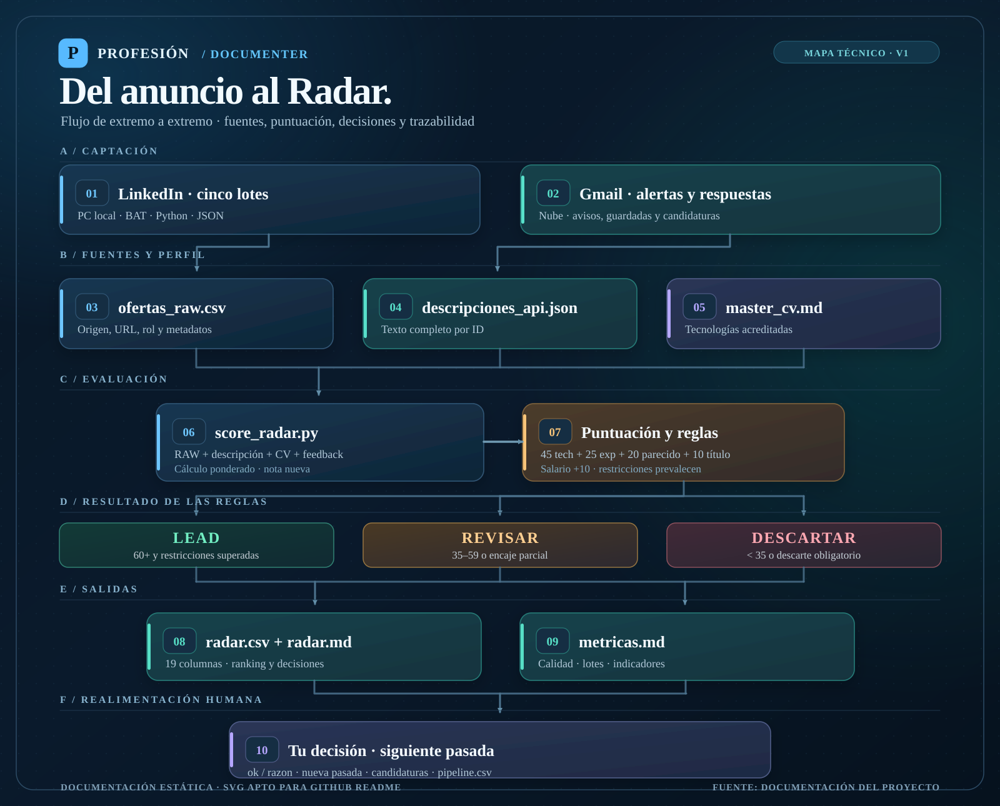

# TrackRadar

[](https://jaterub.github.io/PathfinderSRC/documenter/flujo-radar.html)

**Documenter:** mapa de captación, evaluación y decisiones. [Explorar el HTML interactivo](https://jaterub.github.io/PathfinderSRC/documenter/flujo-radar.html) · [Ver código del motor](./2_motor/radar/score_radar.py).

## Documenter · recorrido explicado

<details open>
<summary><strong>▶ Ver el flujo del Radar (vista previa desplegable)</strong></summary>
<p>De LinkedIn y Gmail a la puntuación contra el CV y la decisión humana.</p>
<table>
<thead><tr><th>Fase</th><th>Entrada o proceso</th><th>Resultado</th></tr></thead>
<tbody>
<tr><td>1 · Captación</td><td>5 lotes LinkedIn + Gmail</td><td>JSON de capturas, alertas y eventos</td></tr>
<tr><td>2 · Datos</td><td><code>ofertas_raw.csv</code> + descripciones por ID + <code>master_cv.md</code></td><td>Ofertas y perfil preparados para comparar</td></tr>
<tr><td>3 · Motor</td><td><code>score_radar.py</code></td><td>Tecnologías 45 + experiencia 25 + parecido 20 + título V1 10 (salario +10, máximo 100); restricciones posteriores</td></tr>
<tr><td>4 · Panel</td><td><code>radar.csv</code> + <code>metricas.md</code></td><td>Lead / revisar / descartar y tus decisiones <code>ok</code> / <code>razon</code></td></tr>
</tbody>
</table>
<p><strong>Prototipo completo:</strong> <a href="https://jaterub.github.io/PathfinderSRC/documenter/flujo-radar.html">HTML interactivo de Documenter</a> · <a href="./docs/documenter/retrospectiva.xml">Retrospectiva XML</a>.</p>
</details>

> **Alcance de la prueba:** GitHub renderiza el HTML básico del README (tabla y desplegable), pero no ejecuta su CSS ni JavaScript interactivo. La versión interactiva del HTML se abre en GitHub Pages. No hay agente Documenter activado.


> Aquí encontrarás dónde está cada cosa. Las carpetas van por **quién las usa**: tú, la máquina que ejecuta o la máquina que guarda.

| Carpeta | Para quién | Qué hay | ¿La tocas? |
|---|---|---|---|
| `1_panel/` | 👤 tú | `informe.md` (empieza aquí cada día) · `radar.csv` / `radar.md` (ofertas pendientes) · `pipeline.csv` (tu funnel) · `metricas.md` (semáforo) | Sí: `radar.csv` (columnas `ok` y `razon`) y `pipeline.csv` (etapas, `tecnologias`) |
| `2_motor/` | ⚙️ la tarea | `entrada/` lee Gmail y captura LinkedIn con Python · `radar/` puntúa · `metricas/` anota costes · `tests/` | No (solo desde la sala de mando) |
| `3_datos/` | 🗄️ la máquina | `ofertas_raw.csv` (nunca se borra) · `entradas_api/` (JSON por día y categoría) · `registros/` (marca de agua, descripciones API, alertas, respuestas, costes, histórico) | No |
| `cv/` · `memory/` | 👤 tú + Claude | CV maestro · memoria del proyecto | Con ok |

## Cómo decides

> A continuación: qué escribir y cuándo se aplica.

| Dónde | Columna | Valores | Cuándo se aplica |
|---|---|---|---|
| `1_panel/radar.csv` | `ok` | `sí` · `aplicada` · `no` · `espera` | Siguiente pasada (L-S 13:00) |
| `1_panel/radar.csv` | `razon` | Texto libre (remoto/híbrido/presencial cuenta). Si dice cerrada («Ya no se aceptan solicitudes») y `ok` es sí/espera/vacío, el motor pone `no` y cierra el lead (con `aplicada` solo avisa) | Siguiente pasada |
| `1_panel/pipeline.csv` | `etapa` · `resultado` · `tecnologias` | Avanzas tú; rechazos y silencio > 30 días los cierra la tarea | Siguiente pasada |

### Tu `razon` cuando dices `no`

> A continuación: escribe libre; el motor lo clasifica por palabras (gana la primera que encaje). Solo «cerrada» no cuenta como error del motor.

| Tipo | Palabras que lo activan (ejemplos) |
|---|---|
| cerrada | cerrada, caducada, expirada, no se aceptan, ya no está, closed, «No longer accepting applications» |
| tecnología | tecnología, stack, herramienta, SAP, AWS, Azure, GCP, cloud, Java, Python, Tableau, Qlik, DevOps, código |
| condiciones | salario, sueldo, presencial, remoto, híbrido, ubicación, lejos, Barcelona, jornada, contrato, horario, viajes, €, «45k» |
| encaje | perfil, nicho, nivel, junior, senior, experiencia, controller, rol, encaja, no soy, no tengo, no me veo |
| otra | cualquier otro texto |

- Copias de una oferta (misma empresa y rol): si ya decidiste una, las copias sin `ok` salen en descartar con «repetida de <id>» y `ok` vacío; si pones `ok` tú en la copia, manda lo tuyo.

### Cómo se ordena `pipeline.csv`

- Arriba las vivas, por etapa más avanzada (la fecha rellena más a la derecha: oferta › entrevista › respuesta › vista › aplicada › lead) y, a igual etapa, la más reciente; abajo las KO / cerradas. Nada se borra (cuentan para las métricas).
- `resultado` dice de dónde viene el cierre: «KO por email» (correo de rechazo, con su fecha) · «KO por silencio» (> 30 días sin respuesta) · lo que escribas tú.
- KO tuyo tras leer la oferta (2-nov): `etapa` = `cerrada` + `resultado` = «KO tras JD: <motivo>». Baja con las KO en la siguiente pasada y no cuenta como error del motor (el acierto del motor solo se mide en `radar.csv`, y el motor puede usar la descripción de API cuando está disponible).
- Fechas siempre AAAA-MM-DD (Excel las muestra como fecha). Guarda desde Excel como «CSV UTF-8 (delimitado por comas)»; si guardas en ANSI o con «;», se lee igual y se avisa.
- Candidaturas por correo: el acuse (LinkedIn o web de la empresa) pone `aplicada` con la fecha del correo y completa rol, url y CV desde el radar; si hay dudas, aviso en el informe.

La captación Python está preparada para 12:00, 12:20 y 12:40 (Europe/Madrid) y el motor Radar se consolida a partir de las 13:00. El horario real de la tarea externa de Claude **debe configurarse y probarse allí**; el repositorio por sí solo no lo activa. La tarea hace push tras validar. Guía: `evidencias/P0.12-claude-python-operacion.md`. El plan general está en `CONTEXTO.md`.

**Trazabilidad:** RAW y `1_panel/radar.csv` incluyen la columna `origen`: `email`, `API` o `email+API` para las ofertas procesadas por ambas fuentes. La columna nueva aparece al ejecutar de nuevo los scripts de importación y puntuación; los CSV antiguos no se modifican solo por cambiar el código.

## Estructura pública del producto

El código extraído de la aplicación está organizado así:

| Ruta | Contenido |
|---|---|
| [motor/](./motor/) | Generador del dashboard y mapa de la extracción pendiente |
| [interfaz/](./interfaz/) | Plantilla HTML/CSS/JavaScript del dashboard v4, sin datos incrustados |
| [clientes/demo-01/](./clientes/demo-01/) | CV de demostración sin identificadores directos y alcance del ejemplo |
| [pruebas/](./pruebas/) | Privacidad del CV y de las rutas de clientes, escape del JSON y render independiente |
| [Contrato técnico](./docs/contrato.md) | Entradas, salidas, privacidad y criterios de extracción |
| [Ingeniería inversa de v4](./docs/ingenieria-inversa-v4.md) | Flujo, dependencias y nota de flexibilidad por cliente |
| [.github/workflows/ci.yml](./.github/workflows/ci.yml) | Pruebas públicas con Python 3.12 |

**Estado:** plantilla y render extraídos; puntuación completa, aplicación del perfil y configuración de búsquedas y alertas todavía pendientes. El mapa de Documenter describe el prototipo de origen; sus rutas de datos y código no implican que toda la aplicación esté ya migrada.

Para ejecutar las comprobaciones desde la raíz del repositorio:

```sh
python -m unittest discover -s pruebas -p "test_*.py" -v
```

Los datos de clientes reales permanecen privados. `clientes/ID*/` está ignorado y prohibido en el índice Git por la comprobación de privacidad.

## Backend · Docker Compose

Requisitos: Docker Desktop iniciado con contenedores Linux y Docker Compose con soporte para `--wait`. Ejecuta desde la raíz del repositorio.

Copia `.env.example` a `.env` si todavía no existe y establece `POSTGRES_PASSWORD` con un valor privado. No publiques ni sobrescribas las credenciales existentes.

### Despliegue

```powershell
docker compose build api
docker compose up -d --wait db
docker compose run --rm --no-deps api /app/.venv/bin/alembic upgrade head
docker compose up -d --wait api
```

Detente si falla algún comando. Alembic aplica las migraciones explícitamente; arrancar FastAPI no crea las tablas.

### Verificación

```powershell
(Invoke-WebRequest -Uri "http://127.0.0.1:8000/health" -UseBasicParsing).StatusCode
docker compose exec -T api /app/.venv/bin/python -c "from api.database import get_engine; from sqlalchemy import text; c = get_engine().connect(); print(c.execute(text('SELECT COUNT(*) FROM users')).scalar()); c.close()"
```

Se espera HTTP 200 y un recuento de usuarios (0 en una base recién migrada). `/health` no consulta PostgreSQL: la segunda comprobación valida la conexión y la tabla.

Swagger: [http://localhost:8000/docs](http://localhost:8000/docs). En Docker Desktop, consulta **Containers → Logs / Terminal** y **Volumes**. Dentro de PostgreSQL, `psql -U pathfinder -d pathfinder` y `\dt` permiten comprobar las tablas; `\q` sale.

### Red y persistencia

- Windows: API en `127.0.0.1:8000`, PostgreSQL en `127.0.0.1:5433`.
- Entre contenedores: la API utiliza `db:5432`, no `localhost`.
- El volumen `postgres_data` conserva los datos al recrear contenedores y con `docker compose down` sin `--volumes`. Cambiar la contraseña en `.env` no actualiza automáticamente una base ya inicializada.
- Para un piloto desde cero sin afectar al original, usa un nombre de proyecto distinto (`-p`) y una copia temporal completa de `compose.yml` sin ambos bloques `ports`. Usa esa copia con `-f` y `--project-directory` apuntando a la raíz en **todos** los comandos. Verifica con `config` que no publica puertos (no muestres la configuración que contiene secretos). Repite el despliegue y verifica HTTP desde el interior de la API y la consulta SQL. Retira solo el piloto con `down --volumes`, su etiqueta de imagen y el YAML temporal. Nunca borres el volumen habitual.

## Autenticacion

- `POST /register`: registro de usuarios.
- `POST /login`: emision de JWT.
- `GET /me`: acceso protegido mediante Bearer Token.
- Passwords: Argon2id y validacion con zxcvbn.
- Caducidad JWT: 15 minutos por defecto, configurable entre 1 y 60 mediante `TOKEN_EXPIRATION_MINUTES`.

### Secretos

Para Docker, generar una clave independiente si el archivo no existe:

    uv run --locked python -c "import secrets; from pathlib import Path; Path('.env.jwt-secret').open('x').write(secrets.token_urlsafe(32))"

En desarrollo local, configurar `JWT_SECRET` en `.env` con una clave aleatoria independiente.

Docker Compose monta `.env.jwt-secret` en `/run/secrets/jwt_secret`.
Nunca publicar estos archivos ni las claves.

Reconstruir la API:

    docker compose up -d --build --wait api

Desde Swagger, registrar un usuario, iniciar sesion, introducir el token en Authorize y ejecutar `/me`.

Validacion automatizada:

    uv run --locked python -m pytest pruebas -q

Pendientes de produccion: HTTPS, limitacion de intentos, rotacion de claves,
deteccion de contrasenas comprometidas y permisos restrictivos de secretos.
