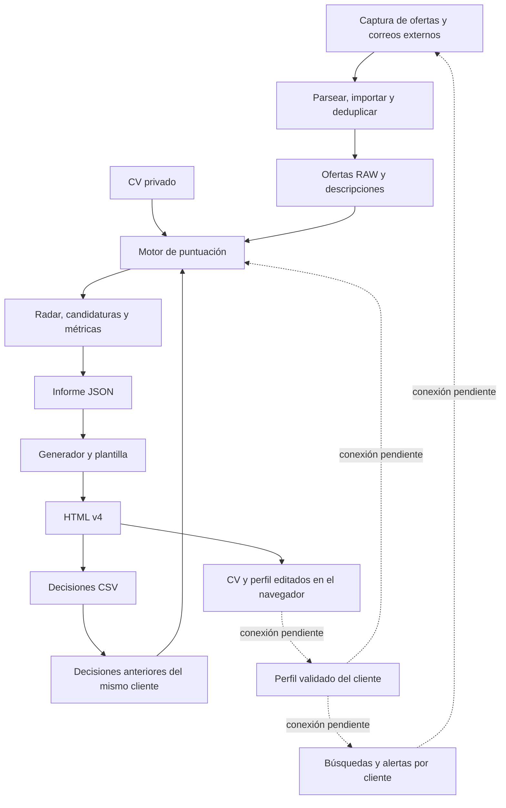

# Dashboard v4 · ingeniería inversa y nota de flexibilidad

## Referencia comprobada

Se ha localizado `dashboard_22nov_v4.html`. Retirando el JSON incrustado en `const D`, coincide exactamente con la plantilla vigente de Profesión. Es una copia generada con datos del usuario; esa copia y sus datos no se publican.

La última entrega del dashboard es **«Decisiones: Guardar escribe en GitHub y la pasada las aplica y archiva»** (PR 154 de Profesión, fusionado). Integra las entregas previas de barra fija, decisiones, perfil e informe (PR 148, 150, 151, 152 y 153). Los PR posteriores de gobierno no cambian este front.

Se extraen ahora la plantilla sin datos a [interfaz/dashboard_plantilla.html](../interfaz/dashboard_plantilla.html) y la función generadora a [motor/dashboard.py](../motor/dashboard.py). En la plantilla solo se cambia el ejemplo del objetivo profesional por un texto sin sector ni ubicación predeterminados. El algoritmo de generación conserva el escape de cierre de script del original.

**Alcance de esta extracción:** código real de presentación y generación. No constituye todavía la extracción del motor completo ni una aplicación para operar clientes reales. El guardado GitHub que se ve en el código es el mecanismo del piloto privado; no se debe conectar a este repositorio público con datos de clientes.

## Lo que hace hoy la versión cuatro

El HTML contiene dos entradas distintas que no deben confundirse:

1. **Informe de resultados:** el motor ya lo ha calculado y lo incrusta como JSON al generar el HTML. La página lo muestra; abrirla no vuelve a buscar ni puntuar ofertas.
2. **CV seleccionado por el usuario:** el navegador lee texto de `.txt` o `.md`, compara literalmente competencias contra las listas mostradas y enseña coincidencias. PDF y DOCX figuran en el selector, pero el código avisa de que aún no los interpreta.

El perfil editado se guarda en el navegador y se descarga como `perfil.json`. No incluye el texto del CV. El motor todavía no lee ese archivo. Ni cargar el CV ni exportar el perfil crea alertas, cambia las búsquedas o ejecuta los scripts Python.

Las decisiones sí tienen circuito de vuelta: se guardan como CSV descargado o, con una credencial, se escriben en GitHub. La siguiente pasada lee los CSV, actualiza las decisiones y los archiva. El perfil tiene pendiente una conexión equivalente, con validación y aplicación explícita.

## Flujo real, seguido desde el HTML hacia atrás

### Contratos que ya utiliza el front

- Informe: `fecha`, `semaforo`, `resumen`, `mejores`, `pendientes`, `a_futuro`, `perfil`, `funnel` y `repo`.
- Perfil exportado: `objetivo`, `salario_min`, `anos_max`, `corte_lead`, `rumbo`, `base`, `resta`, `neutro`.
- Decisiones: `url,ok,razon`. El motor comprueba valores y URLs, aplica los cambios más recientes y archiva los archivos.

## Dependencias y alcance de la extracción completa

Rutas de origen relativas al proyecto privado:

| Pieza existente | Papel en el flujo | Dependencias y tratamiento |
|---|---|---|
| `2_motor/radar/score_radar.py` | Puntuar, preservar decisiones, ordenar radar, actualizar candidaturas y producir informe | Usa `experience.py` y `pipeline_csv.py`; mezcla lógica compartida, perfil y rutas privadas |
| `2_motor/radar/experience.py` | Extraer experiencia exigida y evidencia | Python estándar; conservar rangos, negaciones y distinción entre requisito y dato ausente |
| `2_motor/pipeline_csv.py` | Formato, fechas y orden del seguimiento | Compartido por puntuación y respuestas; trasladar una única definición |
| `2_motor/entrada/importa_api.py` | Incorporar JSON y complementar descripciones sin perder datos | Reutiliza `jd_modalidad` del scorer; preservar deduplicación, migraciones y escrituras seguras |
| `2_motor/entrada/parse_alert.py` y `html_alerta.py` | Convertir correos ya obtenidos en ofertas | No son un cliente Gmail ni crean alertas; reciben contenidos de una integración externa |
| `2_motor/entrada/marca_agua.py` | Consultas y avance del último correo procesado | Marca y registro separados por cliente; conserva validaciones y escritura atómica |
| `2_motor/entrada/respuestas.py` | Acuses, vistas, avances y rechazos de candidaturas | Importa `variante_de_rol` del scorer y el formato compartido del pipeline |
| `2_motor/entrada/captura_linkedin.py` | Captura por categorías, límites, pausas y registro | HTTP, zona horaria y búsquedas configuradas; no se ejecuta durante esta revisión |
| `2_motor/entrada/captura_jornada.py` y BAT | Coordinación temporal y ejecución de la cadena | Categorías y horarios fijos; el BAT además clona, publica datos y escribe en main: no trasladarlo sin adaptación |
| `2_motor/metricas/` | Colores y registro de coste de la pasada | Rutas por cliente; no copiar costes ni registros del usuario |
| `build_informe`, `dashboard_html` y plantilla | Preparar datos y mostrar el panel | El render y la plantilla ya están extraídos; el cálculo del informe sigue en el scorer |
| Pruebas del motor | Fijar parsers, reglas y conservación de decisiones | Algunas son sintéticas; otras leen CV, RAW e historial privados. Estas últimas se quedan en Profesión y se complementan con casos públicos |

El código Python examinado usa biblioteca estándar y módulos propios; no exige añadir un framework para copiar estas piezas. `zoneinfo` necesita datos de zona horaria disponibles en el entorno. El front usa HTML, CSS y JavaScript del navegador, sin React, compilador, CDN ni bibliotecas externas. Sus servicios externos son GitHub para el guardado opcional y las fuentes de ofertas/correo a través del flujo exterior.

## Especificidades que deben salir del código

| Actualmente específico del usuario de Profesión | Fuente actual | Destino flexible |
|---|---|---|
| Catálogos `TECH_RUMBO`, `TECH_BASE`, `TECH_RESTA`, `TECH_NEUTRO`, aliases y contexto | Scorer | Competencias del perfil y catálogo del sector |
| Familias V1–V4, objetivo IA, títulos con puntos, exclusiones y señales de encaje parcial | Scorer y `criterio_revisar.md` | Roles, vocabulario y reglas del perfil; una sola fuente para código y guía |
| Sueldo objetivo de 60k, Madrid, restricciones presenciales y ciudades excluidas | Scorer | Condiciones explícitas del cliente; no inferirlas del CV |
| Máximo de experiencia, KO junior, umbrales de lead y revisión | Scorer | Reglas de evaluación validadas; comprobar también textos de explicación y métricas |
| Fechas de calibración, significado del «sí» fuerte y relanzamiento del CV | Scorer | Estado e historial del cliente, sin importar decisiones de otro usuario |
| Cinco búsquedas de IA, ubicación y ventana temporal | Capturador, BAT, jornada e importador | Plan de búsqueda del perfil; eliminar las listas duplicadas al modificarlas, fijando primero el comportamiento con pruebas |
| Consultas Gmail, fuentes de alertas y frecuencia | Marca de agua, respuestas y tarea externa | Configuración de integración por cliente; la creación de alertas en el portal es un paso distinto |
| Rutas del CV, RAW, panel, descripciones, logs y decisiones | Varios módulos | Carpeta o almacenamiento aislado por cliente |
| Repositorio de destino, rama main y carpeta de decisiones | Generador, HTML y BAT | Configuración de integración; nunca el repositorio privado como valor de la demo |
| Claves `radar_perfil`, `radar_decisiones`, `radar_token` del navegador | HTML | Estado separado por cliente; un prefijo no sustituye autenticación ni permisos |

No basta con extraer un número o una lista: las explicaciones contienen referencias literales a 60k, siete años, IA y Madrid. También deben responder al mismo perfil para que el panel no contradiga la puntuación.

## Nota de flexibilidad

**Un motor compartido; un perfil validado y un estado separados por cliente.** Cambiar de una persona orientada a IA a otra de asesoría fiscal no debe requerir editar el algoritmo, los regex del motor ni una copia de la interfaz.

Para cerrar el flujo previsto:

1. Leer el CV y recoger el objetivo y las condiciones que el cliente confirme. El CV aporta evidencia profesional, no sus preferencias futuras.
2. Mantener un único contrato de perfil. Se propone ampliar el `perfil.json` que ya exporta el front, en lugar de introducir otro formato para la misma información. Debe incorporar referencia al CV, roles, condiciones, competencias, exclusiones y plan de búsqueda.
3. Validar tipos, rangos, campos obligatorios y coherencia antes de activar el perfil. No convertir vacíos en preferencias inventadas. El perfil y sus listas son datos; no código ejecutable.
4. Derivar de ese perfil las búsquedas y la configuración propuesta de alertas. Distinguir generar una propuesta, validar con el cliente y activar una integración. Una API de captura o una consulta Gmail no crea por sí misma una alerta en LinkedIn.
5. Hacer que puntuación, explicaciones, métricas y dashboard consuman el mismo perfil y solo el historial de ese cliente. Conservar la estructura y comportamiento probados antes de cambiar reglas.
6. Separar la demo pública del modo de operación privado. El piloto permite credenciales GitHub en el navegador y escritura de decisiones en un repo: no es el mecanismo de acceso de una aplicación para clientes reales. Las credenciales de servicio y autorización deben quedar en el lado privado del sistema.

Se mantiene la arquitectura pequeña existente: no hay evidencia aquí que justifique añadir microservicios, un framework nuevo o un segundo motor. Primero cerrar estas conexiones con pruebas; después decidir alojamiento e integraciones.

### Criterios de comprobación antes de llamar genérica a la aplicación

- Cambiar entre dos perfiles de sectores distintos cambia vocabulario, condiciones y búsquedas sin editar Python o JavaScript.
- Una preferencia modificada en el perfil afecta al motor, sus motivos y el informe; no se queda solo en el navegador.
- El cliente de fiscalidad no hereda listas de IA, salario, ubicación, experiencia máxima ni decisiones del usuario de Profesión.
- El HTML de una demo se genera solo con datos revisados para publicar, sin apuntar al repositorio privado.
- Se preservan deduplicación, decisiones humanas, errores y validación; la regresión privada de Profesión pasa antes de aprobar la extracción del scorer.
- No se declara activada ninguna alerta hasta comprobar la integración real. Esta revisión no ha hecho consultas de captación, envíos, cambios de tareas ni guardados de decisiones.

## Referencias profesionales aplicadas

- Separar código de configuración y credenciales de despliegue: [The Twelve-Factor App · Config](https://12factor.net/config). El perfil de negocio por cliente es distinto de las credenciales y configuración del despliegue.
- Seleccionar un archivo da acceso de lectura al navegador; la comunicación con un servidor requiere código adicional: [MDN · Using files from web applications](https://developer.mozilla.org/en-US/docs/Web/API/File_API/Using_files_from_web_applications).
- Para la futura subida real de CV: validar archivos, autorización y límites, y separar almacenamiento de la zona pública: [OWASP · File Upload](https://cheatsheetseries.owasp.org/cheatsheets/File_Upload_Cheat_Sheet.html).
- No tratar el almacenamiento del navegador como un lugar seguro para credenciales: [OWASP · HTML5 Security](https://cheatsheetseries.owasp.org/cheatsheets/HTML5_Security_Cheat_Sheet.html).

## Estado comprobado

Localización y correspondencia de v4: comprobadas. Lectura de CV, perfil, decisiones, captación y dependencias: revisadas en código. Plantilla sin datos y render: extraídos. Motor completo por cliente, aplicación del perfil, configuración automática de alertas y autenticación: pendientes. No se ha ejecutado el sistema de producción ni modificado Profesión.
